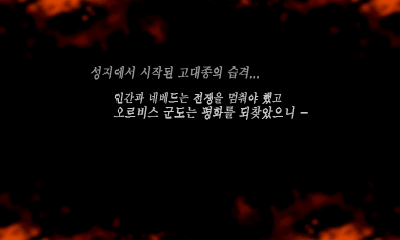
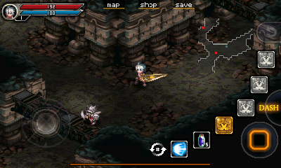

# heroesLore5 — 64비트 네이티브 앱

피처폰 WIPI RPG **히어로즈 로어 5**를 64비트 전용 안드로이드 기기에서 돌리는
네이티브 앱. 원본 `libHeroesLore5.so` (ARMv5TE, `.text` 1.17 MB, 함수 3,394개)
를 **한 바이트도 고치지 않고** AArch64 프로세스 안에서 해석 실행한다.

원본 APK 를 64비트로 "변환"할 수 없는 이유와, 대신 이 구조를 고른 근거는
[`ANALYSIS.md`](ANALYSIS.md) 에 있다.

```
  android_app (arm64-v8a APK)              hl5_probe (헤드리스, PC)
                    \                     /
                     +---- hl5_core ----+
                     |  Vm: CPU·메모리   |
                     |  libc/GL/JNI HLE  |
                     +---------+---------+
                               | ARMv5TE 해석
                     libHeroesLore5.so  (원본 그대로)
```

## 상태 — arm64 APK 가 기기에서 돈다 (2026-08-18)

**`build_android.ps1` 이 `native-code` 가 `arm64-v8a` 하나뿐인 APK 를 내고,
갤럭시 S9 에서 부팅 0.87초·14.5~18.5 fps 로 게임이 돈다.** 원본은 같은 기기에
그대로 설치돼 있고 서로 건드리지 않는다 — 정답지와 재호스트가 한 폰에 있다.

헤드리스 프로브에서는 부팅 → 인트로 → 타이틀 → 메뉴 → 클래스선택 → 컷신 →
던전 → 게임플레이 HUD → 캐시샵 → 구매 왕복까지 폴트 없이 재생된다.

| | |
|---|---|
| import 심볼 | 77 — **76개 전부 서빙** (`--todo` 0) |
| JNI 진입점 | 18 — boot·loop·입력 경로 구현 |
| Java 콜백 | `CletEntry` 55개 룩업 실측, 필요한 것 구현 |
| 정답지 대조 | "Connecting" 평균오차 **1.36** / p95 4 |
| | 클래스선택 평균오차 6.45 / p95 35 |
| 실서버 | 로그인 핸드셰이크 완주, 상점 `6/2→6/5→6/7` 왕복 확인 |
| 호스트 블리터 | `MC_grpFillRect` + `FillRectAlpha` — 게스트 명령어 3.34배 감소, 프레임 바이트 동일 |
| 사설 서버 | 앱 안의 인프로세스 서버(`hl5_core/src/localserver.rs`)가 답한다 — 외부 서버 없이 돈다 |
| WIPI 화면 | 400 × 240 |




남은 것: `DrawImageBlendingClip565` 이식(지금 프레임의 **70.5%** 가 이 한 함수다), 소리.

## 빌드 / 실행

```powershell
cargo build

cargo run -q -p hl5_probe -- --load-only   # 로더가 낸 것 전부
cargo run -q -p hl5_probe -- --todo        # 아직 구현 안 된 import, 그룹별
cargo run -q -p hl5_probe -- --selftest    # HLE 를 트램폴린으로 두드리는 검사 20개
cargo run -q -p hl5_probe -- --ctors       # C++ 정적 생성자
cargo run -q -p hl5_probe -- --boot --frames 120 --dump out/f.png

# 재생 스크립트 — 입력과 덤프를 한 파일로. tools_re/scripts/ 참조
cargo run -q -p hl5_probe -- --boot --script tools_re/scripts/newgame.txt

# 실서버 — 같은 프로토콜을 말하는 서버가 127.0.0.1:7301 에 떠 있을 때
cargo run -q -p hl5_probe -- --boot --server 127.0.0.1:7301 --script tools_re/scripts/ingame.txt

# 게스트 함수를 이름으로 후킹 — 인자와 호출자, C 문자열까지 찍는다
cargo run -q -p hl5_probe -- --boot --watch _ZN10StaticUtil7LoadResEPcPi

# 호스트 블리터 없이 (이식이 바이트 동일한지 보는 A/B 의 기준 쪽)
cargo run -q -p hl5_probe -- --boot --no-patch --film out/film_ref

# 즉시 시작 — StateMainMenu state 0/1 (서버 접속 대기)을 건너뛴다.
# 기본은 original (재생 스크립트·정답지 A/B 가 그 경로를 전제).
cargo run -q -p hl5_probe -- --boot --boot-mode skip-network --frames 40
```

안드로이드 APK:

```powershell
.\build_android.ps1 -Fast -Install        # 릴리스 Rust + 기기 설치
.\build_android.ps1 -Fast -Boot original  # 원본 부팅(접속 대기 포함)으로 빌드
adb -s <serial> logcat -s hl5              # 부팅·fps·폴트
```

앱의 부팅 기본값은 **skip-network** (설치하고 켜면 서버 접속 대기 없이 인트로로
직행)다. 기기에서 바꾸려면 `<files>/hl5_boot.txt` 에 `original` 한 줄.

| 크레이트 | 내용 |
|---|---|
| `hl5_core/` | 런타임 전부. `mem` 게스트 주소공간, `elf` ELF32 로더, `heap` 게스트 할당자, `hle` 트램폴린·import 구현 |
| `hl5_probe/` | 헤드리스 러너. **첫날부터 있다** — 기기 없이 결정적으로 도는 것이 이 프로젝트의 유일한 개발 루프다 |
| `hl5_android/` | arm64 안드로이드 셸 (winit/GameActivity + softbuffer). 에셋에서 게스트를 꺼내고 프레임·터치를 편다 |
| `android_app/` | gradle 프로젝트. ABI 는 `arm64-v8a` 하나, `applicationId` 는 원본과 달라 나란히 설치된다 |
| `vendor/arm32_cpu/` | ARM32 해석기 포크. 크로노스에서 그대로 이관 (ARMv5TE `SMUL<x><y>`·`SMLA*`·`LDRD/STRD`·`cond==0b1111`·`BLX <reg>` 수정 + 디코드 LUT) + 이 게스트가 요구한 `MOVW/MOVT` |

## 준비물

`payload/` 에 원본 APK 에서 꺼낸 파일들이 **들어 있다** — 받은 그대로 빌드된다:

```
payload/libHeroesLore5.so       원본 APK 의 lib/armeabi/libHeroesLore5.so
payload/data.vfs.mp3            원본 APK 의 assets/data.vfs.mp3
payload/icon-{l,m,h}dpi.png     원본 런처 아이콘
payload/classes.dex             원본 Java 셸 — 실행 구조 확인용
payload/AndroidManifest.xml     원본 매니페스트
payload/mtouchdevice.txt        터치 단말 화이트리스트
```

원본 APK 에 딸려 온 IDA 데이터베이스(`libHeroesLore5.so.idb`, 21 MB)는 넣지 않았다.
`tools_re/idb_extract.py` 를 다시 돌릴 때만 필요하고, 거기서 건진 것은
`tools_re/idb_structs.txt` 에 있다.

빌드에 필요한 것 (Windows): Android SDK · NDK 25.1.8937393 · JDK 17+ ·
Rust (`aarch64-linux-android` 타깃과 `cargo-ndk`).

```powershell
.\build_android.ps1                # 디버그 APK
.\build_android.ps1 -NewKeystore   # 릴리스 서명용 키스토어를 만들고 연결 방법을 알려 준다
```

이 저장소는 작업 저장소의 스냅샷이다. `ANALYSIS.md` 와 소스 주석이 가리키는
`CLAUDE.md`(작업 일지), `hl5_server/`(사설 서버), `tools_re/testserver.py` 는
여기에 없다.

## 분석 도구

전부 게임 무관하게 동작하고, `ANALYSIS.md` 의 모든 수치를 다시 낸다.

```bash
pip install pyelftools capstone pillow unicorn

python tools_re/seam_census.py payload/libHeroesLore5.so        # 경계면 전체 보고
python tools_re/xref.py payload/libHeroesLore5.so glDrawArrays  # 호출 지점 추적
python tools_re/disasm.py payload/libHeroesLore5.so <symbol> --frame
python tools_re/symtab.py                                        # 심볼 덤프 재생성
python tools_re/dexconst.py payload/classes.dex CletEntry        # dex 상수 추출
python tools_re/dexmethod.py payload/classes.dex CletEntry onKeyHandleEvent  # dex 역어셈블
python tools_re/dexstrings.py payload/AndroidManifest.xml payload/classes.dex

# 정답지(S9 기기 캡처)와 프로브 프레임 대조. --calibrate 는 밝은 화면 캡처에서
# 게임 사각형을 잡는다
python tools_re/ref_compare.py docs/reference/original-s9-02-class-select.png out/shot/25-class-rogue.png --calibrate docs/reference/original-s9-01-connecting.png --out out/ab.png

pip install python-idb
python tools_re/idb_extract.py    # APK 에 딸려 온 .idb 에서 건질 것만 추출

# 크로노스 소드와의 경계면 대조 — 무엇이 전이되는지
python tools_re/seamdiff.py \
    C:/ChronosSwordNativeAPP/payload/libchronosMian.so \
    payload/libHeroesLore5.so CHRONOS HERO5
```

## 참조

* 방법론: [`apkdeployer2580/32bit-to-64bit-app-migration`](https://github.com/apkdeployer2580/32bit-to-64bit-app-migration)
  — Claude Code 플러그인 마켓플레이스

  ```
  /plugin marketplace add apkdeployer2580/32bit-to-64bit-app-migration
  /plugin install rehost@32bit-to-64bit-app-migration
  ```

* 참조 구현: `C:\ChronosSwordNativeAPP` — 같은 midas 계층으로 만들어진 형제
  게임의 완성된 재호스트.

<!-- release-section -->
## 최신 릴리스 (APK)

**[최신 APK 받기 → Releases](https://github.com/apkdeployer2580/hero5_deploy_repo/releases/latest)**

| 판 | 파일 | versionCode |
|---|---|---|
| 일반판 | `hero5-v1.08-vc90.apk` | 90 |
| vanilla 판 | `hero5-vanilla-v1.08-vc91.apk` | 91 |

일반판은 (진) 종결 무기를 포함한 전부이고, vanilla 판은 (진) 무기를 새로 얻을 수 없다는 것만 다릅니다. 두 판은 같은 앱이라 한 폰에 하나만 설치됩니다. 쓰던 판을 받으세요.

**이미 설치해서 하던 분 — 세이브를 그대로 이어 하려면**

* 앱을 **지우지 말고** 받은 APK 를 그대로 설치하세요. 업데이트로 덮어 설치되고 세이브가 그대로 남습니다.
* ⚠ 앱을 지우면 세이브도 함께 지워지고 되살릴 수 없습니다.
* 「앱이 설치되지 않았습니다」가 뜨면 서명이 다른 APK(예: 이 소스로 직접 빌드한 APK)가 깔려 있는 것입니다. 게임의 환경설정에서 「세이브 내보내기」로 세이브를 파일로 빼 두고, 그 앱을 지운 뒤 새 APK 를 설치해서 「세이브 불러오기」로 넣으세요.
* 공식 APK 의 서명 인증서 SHA-256: `9c834481eda1893c2d3b991950b87e1243b8047659f1fb0a29c52ebc790721eb`
